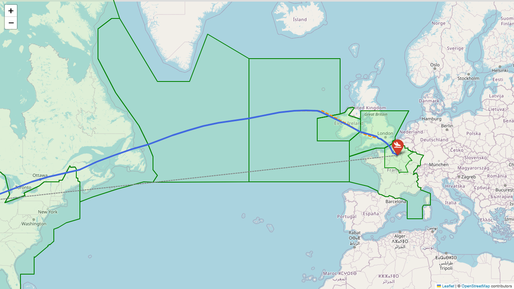
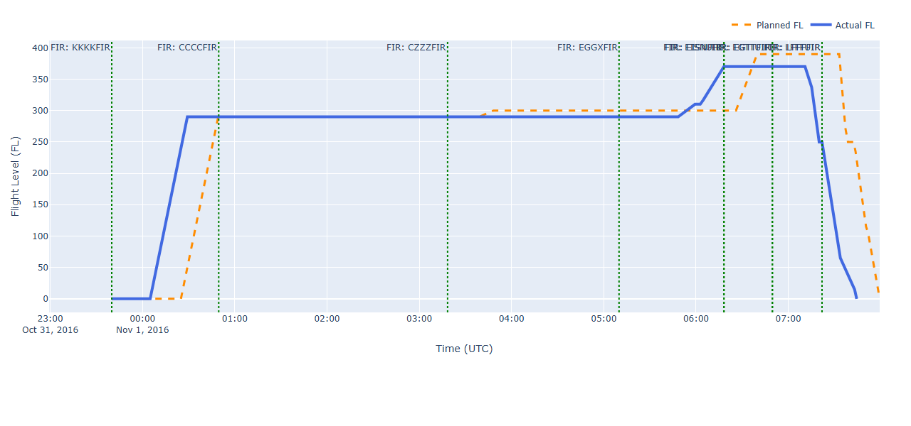
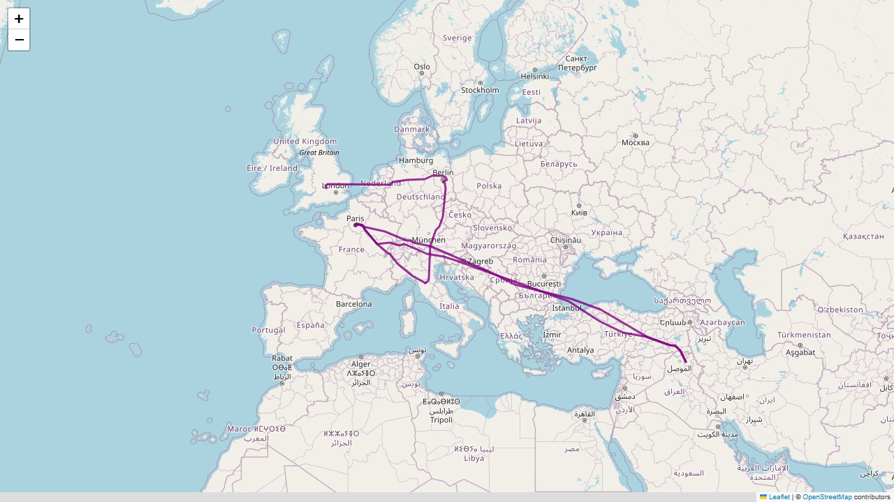
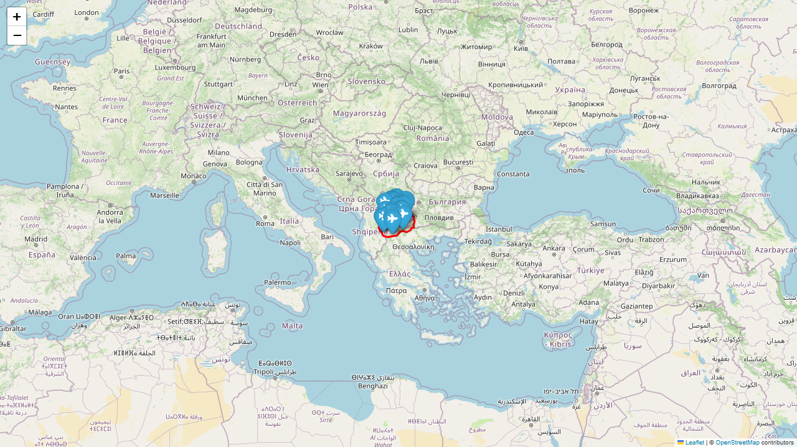
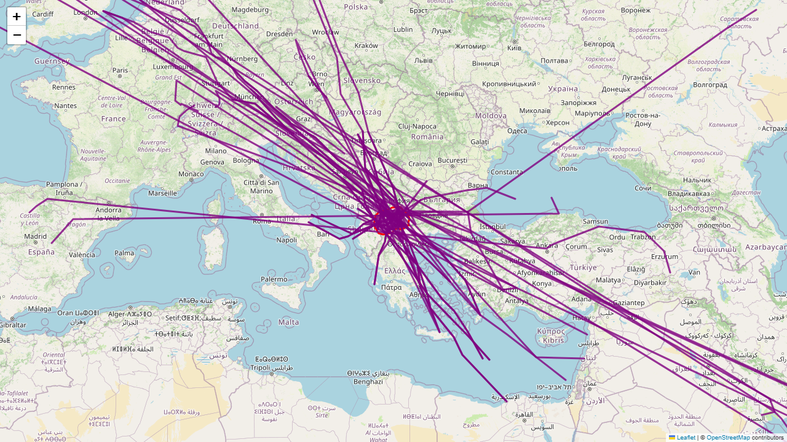
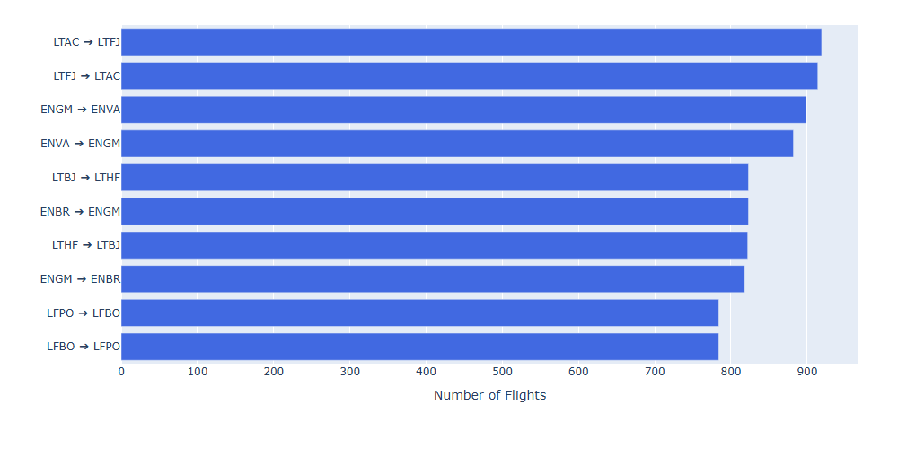
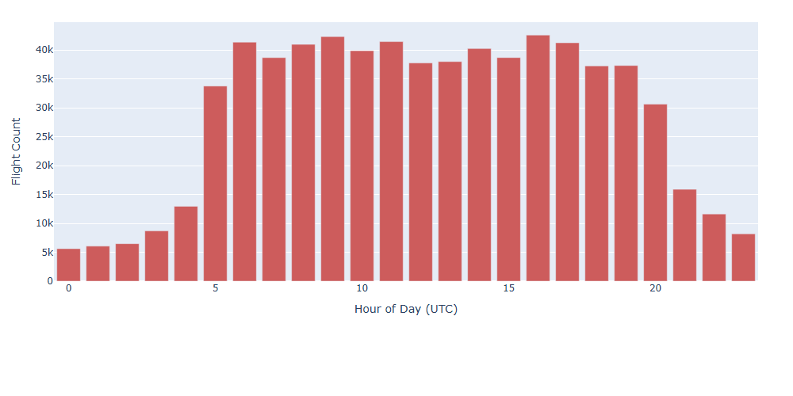

# ectl-flights

[](https://www.python.org/)

A Python library and CLI for repeatable handling of the **EUROCONTROL Aviation Data for Research** archive
(the "R&D data" flight sample). It turns the raw monthly downloads into a single, indexed SQLite
database, and provides spatial and fleet analytics on top of it.

- **Prepare**: extracts `.gz` downloads and copies the raw files to standard names
- **ETL**: loads actual and filed trajectories, flight metadata, FIRs, routes and airports; works out
  the origin and destination airports; computes delays and plan deviation; writes everything to SQLite
- **Analyse**: FIR crossings, great-circle vs planned vs actual efficiency, city pairs, airline route
  dominance, passenger and cargo estimates, traffic patterns
- **Visualise** (optional): ready-made Folium maps and Plotly vertical profiles

<p align="center">
  
</p>

---

## Contents

- [Data](#data)
- [Installation](#installation)
- [Quick start](#quick-start)
- [Command-line interface](#command-line-interface)
- [Python API](#python-api)
- [Visualizations gallery](#visualizations-gallery)
- [Database schema](#database-schema)
- [Methodology notes](#methodology-notes)
- [Development](#development)
- [License](#license)

---

## Data

The flight data is **not** included. Request access and download it from EUROCONTROL:
<https://ext.eurocontrol.int/prisme_data_provision_hmi/>

Put the files for a period in one directory. `ectl prepare` looks for:

| Raw file pattern | Standardised as | Content |
|---|---|---|
| `Flights_YYYYMMDD_YYYYMMDD.csv(.gz)` | `flights.csv` | Per-flight metadata (operator, type, registration, filed times, …) |
| `Flight_Points_Actual_*.csv(.gz)` | `flights_anonymized.csv` | Actual trajectory points |
| `Flight_Points_Filed_*.csv(.gz)` | `planned_flights_anonymized.csv` | Filed flight-plan trajectory points |
| `fir*.csv(.gz)` | `fir.csv` | FIR boundary polygons |
| `Route_*.csv(.gz)` | `routes.csv` | ATS route points |
| `airports*.csv` | `airports.csv` | Airport reference list, e.g. [OurAirports](https://ourairports.com/data/) `airports.csv` |

> **Note:** If more than one file matches a pattern, the first one in alphabetical order is used.
> Process each period in its own directory.

---

## Installation

From a clone of the repository:

```bash
pip install .            # core: pandas, numpy, scipy, shapely, geopy
pip install ".[viz]"     # + folium, plotly
pip install ".[app]"     # + streamlit, streamlit-folium (for dashboards)
```

For development, use an editable install: `pip install -e ".[viz]"`.

Requires Python 3.9+ and Shapely 2.x.

---

## Quick start

```bash
# 1. raw downloads in ./data  ->  ./flights.db
ectl run data/ --db flights.db
```

```python
from ectl_flights import FlightDB, analytics, geo

db = FlightDB("flights.db")
flights = db.summary()                       # one row per flight

# Long-haul flights out of Heathrow cruising above FL350
sel = analytics.filter_flights(flights, origins=["EGLL"], fl_range=(350, 450))

fid = sel["ECTRL ID"].iloc[0]
row = db.flight(fid)
actual, planned = db.actual_points(fid), db.planned_points(fid)

geo.fir_crossings(actual, db.firs)
# [('EGTTFIR', '2016-11-01 10:02:11'), ('EISNFIR', ...), ...]

geo.flight_efficiency(
    actual, planned,
    db.airport_coords(row.origin_airport),
    db.airport_coords(row.destination_airport),
)
# {'ideal_nm': 3608.6, 'planned_nm': 3697.1, 'actual_nm': 3694.0,
#  'planned_efficiency_pct': 97.6, 'actual_efficiency_pct': 97.7}
```

---

## Command-line interface

```text
ectl [-v] prepare [DATA_DIR]               extract .gz files and standardise filenames
ectl [-v] etl     [DATA_DIR] [--db PATH]   build SQLite db from standardised CSVs
ectl [-v] run     [DATA_DIR] [--db PATH]   prepare + etl
```

`DATA_DIR` defaults to `.` and `--db` defaults to `flights.db`. Use `-v` for debug logging.

---

## Python API

### `ectl_flights.prepare`

| Function | Description |
|---|---|
| `prepare(data_dir)` | `extract_gz` + `standardize`; returns `{standard_name: Path}` |
| `extract_gz(data_dir)` | Decompress any `*.gz` not already extracted |
| `standardize(data_dir)` | Copy raw files to the standard names in `FILE_PATTERNS` |

### `ectl_flights.etl`

| Function | Description |
|---|---|
| `run_etl(data_dir, db_path)` | Full pipeline; returns the flight summary DataFrame |
| `load_raw(data_dir)` | Dict of DataFrames: `actual`, `planned`, `meta`, `airports`, `firs`, `routes` |
| `build_flight_summary(actual, planned, meta, airports)` | Per-flight summary (in-memory, no DB required) |
| `write_database(frames, summary, db_path)` | Write tables and indices |
| `NearestAirport(airports).query(latlons)` | KD-tree nearest-airport lookup |

### `ectl_flights.FlightDB`

```python
with FlightDB("flights.db") as db:
    db.summary()                         # DataFrame copy, datetimes parsed (cached)
    db.airports                          # ident, name, lat, lon (cached)
    db.firs                              # {fir_id: {'latlon': [...], 'shape': Polygon}} (cached)
    db.routes                            # {route_id: {'latlon': [...], 'shape': LineString}} (cached)
    db.flight(ectrl_id)                  # summary row (Series)
    db.actual_points(ectrl_id)           # ordered trajectory points
    db.planned_points(ectrl_id)
    db.flights_for_registration("REG")
    db.airport_coords("EGLL")            # (lat, lon) or None
    db.query("SELECT ... WHERE x = ?", (val,))
```

### `ectl_flights.geo`

| Function | Description |
|---|---|
| `fir_crossings(points, firs)` | `[(fir_id, first_entry_time), …]` sorted by time |
| `firs_passed(points, firs)` | FIR IDs only |
| `flight_efficiency(actual, planned, origin, dest)` | Ideal / planned / actual nm and efficiency % |
| `path_distance_nm(points)` | Geodesic length along a trajectory |
| `great_circle_nm(a, b)` | Geodesic distance between two `(lat, lon)` points |
| `airports_in_fir(shape, airports)` | Airports inside a FIR polygon |
| `routes_in_fir(shape, routes)` | Route IDs intersecting a FIR polygon |
| `build_fir_polygons(df)`, `build_route_lines(df)` | Build geometries from raw tables |

### `ectl_flights.analytics`

| Function | Description |
|---|---|
| `filter_flights(summary, date_range, origins, destinations, fl_range, operators)` | Filter the summary by date, airports, flight level and operator |
| `add_capacity_estimates(summary)` | Adds `Est_Passengers`, `Est_Cargo_Tonnes`, `City_Pair` |
| `top_city_pairs(summary, n)` | Flight count, mean departure delay and most common aircraft type per pair |
| `airline_routes(summary, operator=None)` | Flight count and mean distance per operator and pair |
| `operator_throughput(summary)` | Flights, estimated passengers and cargo per operator |
| `flights_touching_airports(summary, idents)` | Flights departing from or arriving at the given airports |
| `traffic_by_weekday(summary)`, `traffic_by_hour(summary)` | Departure counts |

You can edit `AC_CAPACITY`, `DEFAULT_CAPACITY` and `FREIGHTER_CARGO_FACTOR`, or pass your own
capacity table to `add_capacity_estimates`.

### `ectl_flights.viz` *(requires `[viz]`)*

```python
from ectl_flights import viz

viz.flight_map(actual, planned, db.firs, ideal=(orig, dest)).save("flight.html")
viz.vertical_profile(actual, planned, db.firs).show()
viz.multi_flight_map([("tooltip", df), ...])
viz.fir_map(fir_id, db.firs[fir_id], airports=..., routes=db.routes, route_ids=[...])
viz.bar(x, y, horizontal=True)
```

---

## Visualizations gallery

Sample PNG exports produced from the dataset:

### 1. Single Flight Trajectory Map (`viz.flight_map`)
Actual flown trajectory in royal blue, filed flight plan in dark orange dashed line, great-circle direct route in gray dotted line, departure/arrival airport markers, and crossed FIR airspace boundary polygons in green:

```python
viz.flight_map(actual_points, planned_points, db.firs, ideal=(orig_coords, dest_coords))
```

<p align="center">
  
</p>

### 2. Vertical Altitude Profile with FIR Crossings (`viz.vertical_profile`)
Flight level (FL) vs. UTC time for planned vs. actual flight levels, with green dotted vertical lines marking the entry boundary time for each crossed FIR:

```python
viz.vertical_profile(actual_points, planned_points, db.firs)
```

<p align="center">
  
</p>

### 3. Fleet Registration Tracker (`viz.multi_flight_map`)
Multi-leg network movement overlay for a specific airframe registration across consecutive operational flights:

```python
paths = [
    (f"Flight {f['ECTRL ID']}: {f['origin_airport']} -> {f['destination_airport']}", db.actual_points(f["ECTRL ID"]))
    for _, f in reg_flights.iterrows()
]
viz.multi_flight_map(paths, color="purple")
```

<p align="center">
  
</p>

### 4. FIR Airspace Analytics (`viz.fir_map`)
Airspace boundary polygon with enclosed airports (left) or intersecting ATS network routes (right):

```python
viz.fir_map(fir_id, fir_data, airports=contained_airports)
viz.fir_map(fir_id, fir_data, routes=db.routes, route_ids=intersecting_routes)
```

| Enclosed Airports (`LWSSFIR`) | Intersecting ATS Routes (`LWSSFIR`) |
|:---:|:---:|
|  |  |

### 5. Traffic & Route Network Analytics (`viz.bar`)
High-density airport city pairs (left) and UTC hourly departure distribution (right):

```python
viz.bar(top_pairs["City_Pair"], top_pairs["Flight_Count"], horizontal=True, color="royalblue")
viz.bar(hourly["Dep_Hour"], hourly["Flights"], horizontal=False, color="indianred")
```

| Top City Pairs (Ranked by Flights) | Hourly Departures (UTC) |
|:---:|:---:|
|  |  |

---

### Regenerating the Gallery

All sample images can be regenerated with:
```bash
python generate_samples.py
```

---

## Visualizations gallery

Sample PNG exports produced from the dataset:

### 1. Single Flight Trajectory Map (`viz.flight_map`)
Actual flown trajectory in royal blue, filed flight plan in dark orange dashed line, great-circle direct route in gray dotted line, departure/arrival airport markers, and crossed FIR airspace boundary polygons in green:

```python
viz.flight_map(actual_points, planned_points, db.firs, ideal=(orig_coords, dest_coords))
```

<p align="center">
  
</p>

### 2. Vertical Altitude Profile with FIR Crossings (`viz.vertical_profile`)
Flight level (FL) vs. UTC time for planned vs. actual flight levels, with green dotted vertical lines marking the entry boundary time for each crossed FIR:

```python
viz.vertical_profile(actual_points, planned_points, db.firs)
```

<p align="center">
  
</p>

### 3. Fleet Registration Tracker (`viz.multi_flight_map`)
Multi-leg network movement overlay for a specific airframe registration across consecutive operational flights:

```python
paths = [
    (f"Flight {f['ECTRL ID']}: {f['origin_airport']} -> {f['destination_airport']}", db.actual_points(f["ECTRL ID"]))
    for _, f in reg_flights.iterrows()
]
viz.multi_flight_map(paths, color="purple")
```

<p align="center">
  
</p>

### 4. FIR Airspace Analytics (`viz.fir_map`)
Airspace boundary polygon with enclosed airports (left) or intersecting ATS network routes (right):

```python
viz.fir_map(fir_id, fir_data, airports=contained_airports)
viz.fir_map(fir_id, fir_data, routes=db.routes, route_ids=intersecting_routes)
```

| Enclosed Airports (`LWSSFIR`) | Intersecting ATS Routes (`LWSSFIR`) |
|:---:|:---:|
|  |  |

### 5. Traffic & Route Network Analytics (`viz.bar`)
High-density airport city pairs (left) and UTC hourly departure distribution (right):

```python
viz.bar(top_pairs["City_Pair"], top_pairs["Flight_Count"], horizontal=True, color="royalblue")
viz.bar(hourly["Dep_Hour"], hourly["Flights"], horizontal=False, color="indianred")
```

| Top City Pairs (Ranked by Flights) | Hourly Departures (UTC) |
|:---:|:---:|
|  |  |

---

### Regenerating the Gallery

All sample images can be regenerated with:
```bash
python generate_samples.py
```

---

## Database schema

| Table | Source | Notes |
|---|---|---|
| `actual_flights` | Actual points | Indexed on `ECTRL ID` |
| `planned_flights` | Filed points | Indexed on `ECTRL ID` |
| `flight_summary` | Derived | One row per flight; indexed on `ECTRL ID`, `AC Registration` |
| `firs_raw` | FIR file | Ordered by `Airspace ID`, `Sequence Number` |
| `routes_raw` | Route file | Ordered by `Route ID`, `Sequence Number` |
| `airports_db` | Airports file | Rows without coordinates are dropped |

Columns that `flight_summary` adds to the metadata:

| Column | Meaning |
|---|---|
| `actual_dep_time`, `actual_arr_time` | First and last actual point time |
| `planned_dep_time`, `planned_arr_time` | First and last filed point time |
| `max_actual_fl`, `max_planned_fl` | Highest flight level |
| `actual_waypoints`, `planned_waypoints` | Point counts |
| `dep_lat/lon`, `arr_lat/lon` | First and last actual position |
| `origin_airport`, `destination_airport` (+ `_name`) | Airport nearest to the first and last actual position |
| `dep_delay_mins` | `actual_dep_time − FILED OFF BLOCK TIME` |
| `arr_delay_mins` | `actual_arr_time − FILED ARRIVAL TIME` |
| `deviation_pct` | Difference between actual and filed point counts, as % of filed points |

---

## Methodology notes

These are approximations. Keep them in mind when interpreting results:

- **Origin and destination** are the airports nearest to the first and last actual trajectory points
  (KD-tree on lat/lon in radians). They are not the filed ADEP/ADES. Flights whose recorded
  trajectory starts or ends away from an airport may be matched to the wrong one.
- **Delays** compare the first and last trajectory point times with the filed off-block and arrival
  times. They are not true off-block or on-block delays.
- **FIR crossings** count only the trajectory points that fall inside each FIR polygon. A FIR that is
  crossed between two widely spaced points is missed. Invalid FIR polygons are skipped.
- **Efficiency** is great-circle distance ÷ flown path length × 100.
- **Passenger and cargo estimates** use a small typical-capacity table per aircraft type, with a default
  for types not in it. Flights whose market segment contains "Cargo" get 0 passengers and 2.5× cargo.
- **Stored times:** waypoint `Time Over` values come back from SQLite as strings. `FlightDB.summary()`
  converts the summary's time columns to datetimes.

---

## Development

```bash
git clone <repo-url> && cd ectl-flights
python -m venv .venv && . .venv/bin/activate   # Windows: .venv\Scripts\activate
pip install -e ".[app]"
```

Project layout:

```text
src/ectl_flights/
  prepare.py   extraction & filename standardisation
  etl.py       loading, summary, SQLite writer
  db.py        FlightDB reader
  geo.py       spatial helpers
  analytics.py tabular analytics
  viz.py       folium / plotly (optional)
  cli.py       `ectl` entry point
```

---

## License

Free to use, no restrictions.


